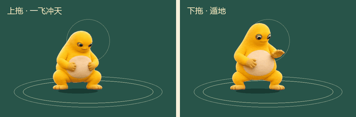

<p align="center">
  
</p>

<h1 align="center">太极团子 · 练功场</h1>
<p align="center"><strong>往左跑，往右跑。往上一拽，一飞冲天。往下一拽，原地遁地。</strong></p>
<p align="center">
  <a href="https://github.com/zgc37359-lang/taiji-tuanzi/archive/refs/heads/main.zip"></a>
  <a href="pets/spritesheet-v2.png"></a>
  <a href="LICENSE"></a>
</p>

## 🥋 上场试招

<p align="center">
  
</p>

| 手势 | 团子的反应 |
| --- | --- |
| **← → 左右拖** | 顺着指针跑，反向拖就掉头，松手收势 |
| **↑ 向上拖** | 屈膝蓄力，冲出画面顶部，再落回练功台 |
| **↓ 向下拖** | 低头按掌，整只钻进地里，再探头钻出来 |
| **点按 / 移动指针** | 点按会抱拳挥掌，待机时绿眼睛会跟着指针转 |

想过招就点 **「开始跟练」**，连做招呼、右移、左移、轻跳、推掌五个动作。想看动作做了哪些变化，点右上角切换初版与加强版。

点击场地后也能用方向键和空格。手机和平板可以直接用手指拖动。

## ⚡ 三步开练

1. [下载 ZIP](https://github.com/zgc37359-lang/taiji-tuanzi/archive/refs/heads/main.zip)。
2. 解压后用现代浏览器打开 `index.html`。
3. 按住团子，往上拖。

页面由 HTML、CSS 和原生 JavaScript 构成，无需安装依赖。开发时也可以在仓库根目录启动静态服务器，再打开 `http://localhost:8000/`。

```bash
python -m http.server 8000
```

修改交互后，用 Node.js 20 或更新版本跑一遍检查。

```bash
node test/interactions.cjs
```

测试涵盖横拖换向、冲天回场、遁地遮挡、点按、键盘、版本切换和五步跟练。

## 🐾 把团子带进 ChatGPT Work

[下载 Pets v2 精灵图](pets/spritesheet-v2.png)，交给支持自定义宠物的 Pets 插件校验并上传。透明 PNG 尺寸为 **1536 × 2288**，包含 **73 帧**、**9 种状态动画**和 **16 个视线方向**。

**冲天和遁地是网页练功场的招式。** ChatGPT Work 当前的 Pets 格式没有开放纵向拖动的动作绑定。[纵向动作素材](assets/vertical-poses.webp)

## 🛠 拆开看看

| 路径 | 内容 |
| --- | --- |
| [index.html](index.html) / [assets/playground.css](assets/playground.css) | 试玩页面与样式 |
| [src/playground.js](src/playground.js) | 拖动判定、逐帧播放、跟练与版本切换 |
| [pets/](pets/) | ChatGPT Work 兼容精灵图 |
| [assets/](assets/) | 初版素材、纵向动作和演示动图 |
| [test/interactions.cjs](test/interactions.cjs) | 交互逻辑检查 |

代码和发行素材使用 [MIT 许可证](LICENSE)。

## ⭐ Star History

<p align="center">
  <a href="https://www.star-history.com/#zgc37359-lang/taiji-tuanzi&Date">
    <picture>
      <source media="(prefers-color-scheme: dark)" srcset="https://api.star-history.com/svg?repos=zgc37359-lang/taiji-tuanzi&amp;type=Date&amp;theme=dark">
      
    </picture>
  </a>
</p>
